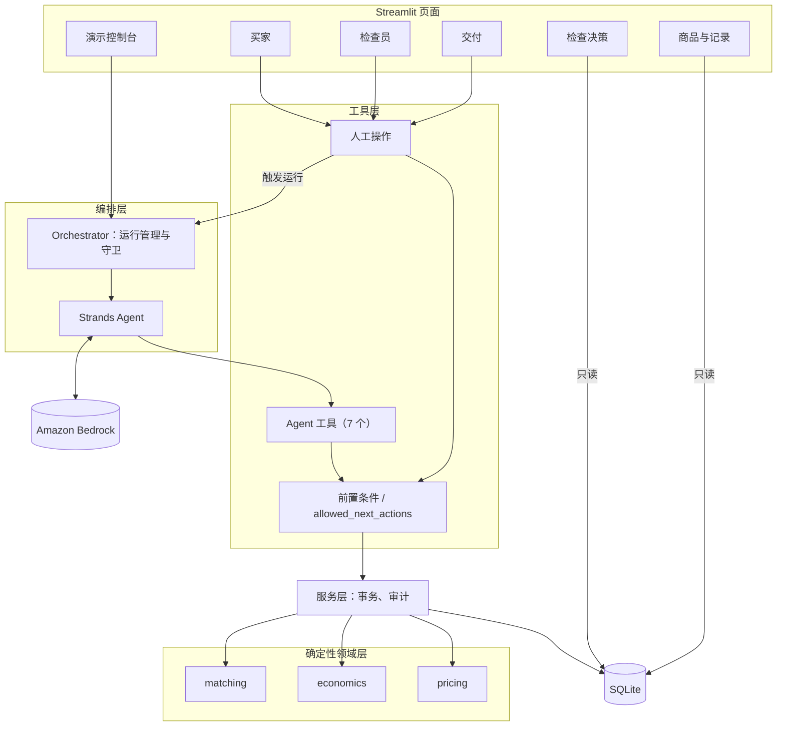
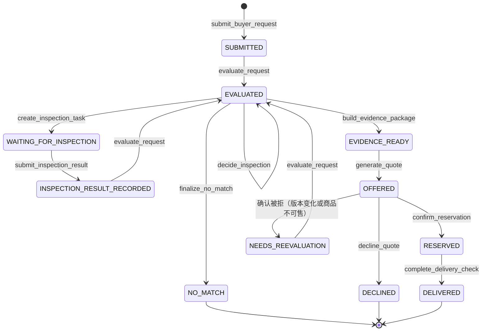
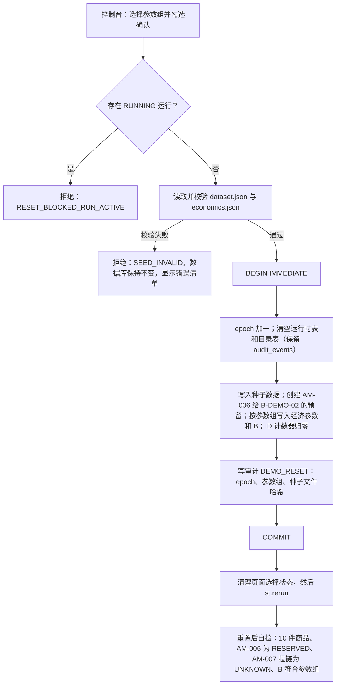

# 技术设计：AcceptMatch MVP（AM-007 缺陷证据核验与匹配）

## 1. 概述

本设计实现 `requirements.md` 中的 MVP，要点如下：

- 一个本地运行的 Streamlit 应用，按角色分为六个页面。
- 匹配资格、检查经济判断、价格、预留和交付核验全部放在纯 Python 的确定性领域层。
- Strands Agent 调用 Amazon Bedrock 模型，只能通过一组受控工具推进流程。工具在数据库事务内重新校验前置条件后才改变状态。
- 所有状态持久化在本地 SQLite 文件中。Bedrock 失败或超时后，已提交的操作保留，相关请求进入暂停；恢复时由一次新的 Agent 运行从数据库状态继续。
- 数据只来自仓库内的合成种子文件，不读取 `Hackathon/Dataset`。

### 1.1 关键设计决策

| 决策 | 选择 | 理由 |
|---|---|---|
| 状态存储 | SQLite（标准库 `sqlite3`，WAL 模式） | 单文件，支持事务和部分唯一索引；进程重启后状态仍在，可满足需求 12.9 的恢复要求 |
| Agent 对话历史 | 不持久化，每次运行新建 Agent | 数据库是唯一事实来源，恢复不依赖对话记录 |
| 人工动作 | 买家确认、检查结果、交付扫描只能从页面发起，不作为 Agent 工具 | 满足需求 12.8，Agent 无法代替人操作 |
| 下一步约束 | 同一组前置条件函数既生成 `allowed_next_actions`，又在工具内强制校验 | 允许列表和实际校验不会出现不一致 |
| 金额 | 以整数分存储，用 `Decimal` 计算，每步 ROUND_HALF_UP 到 0.01 | 避免浮点误差，满足需求 4.5 和价格规则 |
| 面向买家的文字 | 按原因码从模板生成，不使用 Agent 文本 | 满足需求 4.15 和 12.7 |
| 幂等 | 用业务自然键去重（例如"请求 + 商品 + 状态版本"） | 恢复后重复调用会返回已有结果，不会重复扣预算或重复建任务 |
| ID | 每个演示轮次内按序号生成（`REQ-0001`、`DEC-0001` 等） | 每次重置后 ID 相同，便于演示和测试比对 |

### 1.2 技术栈

| 组件 | 版本 | 说明 |
|---|---|---|
| Python | ≥ 3.11 | Streamlit 1.66 要求 ≥ 3.11。本机当前为 3.9.6，实施前需要安装 3.11 或更高版本 |
| strands-agents | 1.61.0 | PyPI 当前最新版（2026-10-14 发布） |
| streamlit | 1.66.0 | PyPI 当前最新版（2026-10-14 发布） |
| pydantic | 2.x | 用于工具入参和种子数据校验 |
| boto3 / botocore | 1.x | Strands 的依赖，用于配置超时 |
| pytest、hypothesis | — | 测试 |

实施时把所有依赖写入 `requirements.txt` 并锁定精确版本。

### 1.3 目录结构

```
accept_match_git/
├── app/
│   ├── streamlit_app.py            # st.navigation 入口
│   └── pages/                      # console / buyer / inspector / delivery / decisions / items
├── acceptmatch/
│   ├── config.py                   # 环境变量与常量
│   ├── domain/                     # 纯函数：enums、models、matching、economics、pricing
│   ├── store/                      # schema.sql、连接与事务、仓储
│   ├── services/                   # 应用服务：每个操作一个事务，并写审计
│   ├── tools/                      # 统一返回结构、Agent 工具、人工操作、前置条件
│   ├── agent/                      # Orchestrator、系统提示、守卫
│   └── ui/                         # 原因码消息模板、页面组件
├── data/seed/
│   ├── dataset.json                # 十件商品、买家、价格规则、检查方法
│   └── economics.json              # 检查经济参数和三个演示参数组
├── tests/
├── .streamlit/config.toml          # server.address = "localhost"
└── var/acceptmatch.db              # 运行时数据库（加入 .gitignore）
```

## 2. 架构



| 层 | 职责 | 不负责 |
|---|---|---|
| Streamlit 页面 | 收集人工输入，从数据库读取并展示状态 | 业务判断 |
| Orchestrator | 创建和结束 Agent 运行，执行守卫，处理失败和恢复 | 业务判断 |
| Strands Agent | 从 `allowed_next_actions` 中选择下一个工具，并写简短说明 | 计算、改状态、代替人确认 |
| 工具层 | 校验入参，执行前置条件，调用服务，返回统一结构 | 规则本身 |
| 领域层 | 匹配、经济判断、价格计算（无 I/O 的纯函数） | 持久化 |
| 服务层 | 在一个事务内完成读取、调用领域层、写入和审计 | — |

### 2.1 Agent 与确定性代码的分工

| 由 Agent 决定 | 由确定性代码决定 |
|---|---|
| 在 `allowed_next_actions` 中调用哪个工具 | 匹配结果、排除原因和排名 |
| 何时结束本次运行 | 经济判断、预算校验和扣减 |
| 给演示负责人的简短说明（经过数值守卫） | 是否允许创建检查任务 |
| | 报价金额、能否预留、交付是否通过 |
| | 所有状态变更 |

MVP 中每个请求状态下允许的 Agent 动作通常只有一个。Agent 负责驱动流程和解释，但不影响业务结果，所以需求 14 的演示结果不依赖模型的具体输出。

## 3. 领域模型

### 3.1 枚举

| 枚举 | 取值（显示名） |
|---|---|
| Point | `FRONT`（正面）、`BACK`（背面）、`ZIPPER`（拉链） |
| DefectType | `SCRATCH`（划痕）、`STAIN`（污渍）、`DENT`（凹陷）、`JAM`（卡滞） |
| Severity | `MINOR`（轻微）< `MODERATE`（中等）< `SEVERE`（严重） |
| PointStatus | `OK`、`DEFECT`、`UNKNOWN` |
| ItemStatus | `INTAKE`、`AVAILABLE`、`RESERVED`、`DELIVERED` |
| MatchResult | `QUALIFIED`、`NEEDS_INSPECTION`、`EXCLUDED` |
| Verdict | `INSPECT`、`SKIP` |
| EvidenceSource | `INTAKE`（入库检测）、`INSPECTION`（人工检查） |

### 3.2 Buyer_Request 状态机



`halted` 是与状态并行的标志（见 7.6）。`halted = 1` 时，该请求上的所有写操作都会被拒绝，只有演示负责人执行恢复或重置后才能继续。

### 3.3 Condition_Record 版本

- 种子数据中每件商品的版本为 1。每次接受检查结果都会写入一个不可变的新版本快照，`items.condition_version` 指向当前版本，旧版本和旧 Evidence 全部保留。
- 匹配评估、Inspection_Decision、证据包和 Quote 都记录所依据的版本号。版本变化后，这些记录不再满足前置条件，自动失效。

## 4. 确定性领域逻辑

### 4.1 匹配（需求 3）

输入是 Buyer_Request、所有商品的当前 Condition_Record，以及该请求的 `request_exclusions`。对每件商品计算所有适用的原因码：

1. `PRODUCT_MISMATCH`：型号与请求不同。
2. `NOT_AVAILABLE`：Item_Status 不是 `AVAILABLE`。
3. `REQUIREMENT_NOT_MET`：Required_Conditions 中的部位为 `DEFECT`，记录该部位。
4. `UNACCEPTED_DEFECT`：不属于 Required_Conditions 的部位上，有缺陷未被 Accepted_Defects 覆盖（覆盖要求部位相同、类型相同、程度 ≤ 可接受的最高程度），记录该缺陷。
5. 再追加 `request_exclusions` 中该商品的原因码（`INSPECTION_OVER_BUDGET`、`INSPECTION_NOT_WORTHWHILE`、`ECONOMICS_INPUT_INVALID`、`INSPECTION_INCONCLUSIVE`）。

有任一原因码的商品记为 `EXCLUDED`。没有原因码时，存在 `UNKNOWN` 部位的记为 `NEEDS_INSPECTION`，否则记为 `QUALIFIED`。排名规则是 `QUALIFIED` 在前、`NEEDS_INSPECTION` 在后，同类按 Item_ID 升序。`EXCLUDED` 商品只出现在明细中，不参与排名。

### 4.2 价格（需求 9）

- `rate_sum` = 每个 Verified_Defect 按程度查出的折扣率之和。程度在规则中没有对应折扣率时，返回 `PRICE_RULE_MISSING`。
- `amount = max(base × (1 − rate_sum), base × 0.50)`，ROUND_HALF_UP 到 0.01，并记录 `floor_applied`。
- 提供 `assume_unknown_ok` 选项：把 `UNKNOWN` 部位视为无缺陷，只用于计算 R_pass 的"通过后报价"，不会生成 Quote（需求 4.3）。

### 4.3 经济判断（需求 4）

输入：C、p、H、R_fail、不检查选项列表、B，以及由 4.2 算出的 `pass_quote`。

步骤如下，每步都四舍五入到 0.01：

| 步骤 | 公式 |
|---|---|
| R_pass | `pass_quote − H` |
| s1 | `p × R_pass` |
| s2 | `(1 − p) × R_fail` |
| EV_inspect | `s1 + s2 − C` |
| V_none | `max(各不检查选项的 net)`，并记录被选中的选项 |
| ΔEV | `EV_inspect − V_none` |
| 预算 | `C ≤ B` |

判定规则：

- 参数缺失，或 p ∉ [0, 1]，或任一金额为负：判定 `SKIP`，原因码 `ECONOMICS_INPUT_INVALID`，并列出有问题的参数，不使用默认值。
- 否则同时完成两项检查：`C > B` 时加 `INSPECTION_OVER_BUDGET`，`ΔEV ≤ 0` 时加 `INSPECTION_NOT_WORTHWHILE`。没有原因码则判定 `INSPECT`，否则判定 `SKIP`。
- 判定为 `SKIP` 时，`recommended_disposition` = V_none 对应的选项。该处置只记录，不执行。
- 不检查选项的 `kind` 只允许 `LIQUIDATE_AS_IS` 和 `RETURN_TO_VENDOR`，加载种子数据时校验（需求 4.4）。

## 5. 状态存储

### 5.1 文件、连接与事务

- 数据库文件为 `var/acceptmatch.db`，实施时把 `var/` 加入 `.gitignore`。
- 每个操作打开一个短生命周期连接，设置 `journal_mode=WAL`、`foreign_keys=ON`、`busy_timeout=5000`。Streamlit 每个会话运行在独立线程中，不跨线程共享连接。
- 写操作使用 `BEGIN IMMEDIATE`，在同一事务内完成：读取并校验前置条件、调用领域层、写入业务表、写 `audit_events`，Agent 工具还要写 `tool_calls`。提交之后操作才算完成，因此每个已完成的工具操作都一定有对应记录（需求 12.9）。
- 被拒绝的 Agent 工具调用会回滚所有业务写入，只在单独的事务中写 `tool_calls` 和 `audit_events` 两条拒绝记录（需求 12.3、13.1）。

### 5.2 表

| 表 | 主要字段 | 说明 |
|---|---|---|
| `meta` | `epoch`、`parameter_set`、`seed_hash`、`reset_at` | 每次重置 `epoch` 加一 |
| `id_counters` | `prefix`、`next_value` | 每轮演示内按序号生成 ID，重置后归零 |
| `products` | `product_id`、`base_price_cents`、`synthetic` | |
| `price_rules` | `severity`、`rate` | |
| `buyers` | `buyer_id`、`label`、`synthetic` | |
| `items` | `item_id`、`product_id`、`tag_code`、`item_status`、`condition_version`、`synthetic` | |
| `condition_versions` | `item_id`、`version`、`points_json`、`source_event_id`、`created_at` | 不可变快照，`points_json` 包含各部位的状态、缺陷和 evidence_ids |
| `evidence` | `evidence_id`、`item_id`、`point`、`source`、`inspector_id`、`recorded_at`、`photo_ref`、`inspection_task_id`、`synthetic` | 只追加 |
| `economics_params` | `item_id`、`inspection_points_json`、`c_cents`、`p`、`h_cents`、`r_fail_cents`、`options_json`、`synthetic` | 按当前参数组加载 |
| `inspection_budget` | `remaining_cents`、`initial_cents`、`budget_version` | 单行；每次扣减 `budget_version` 加一 |
| `buyer_requests` | `request_id`、`buyer_id`、`product_id`、`accepted_defects_json`、`required_conditions_json`、`status`、`halted`、`halt_reason`、`halted_run_id`、`no_match_json` | |
| `request_exclusions` | `request_id`、`item_id`、`reason_code`、`detail_json`、`source_id` | 由经济判断 SKIP 和 INCONCLUSIVE 写入 |
| `match_evaluations` | `evaluation_id`、`request_id`、`results_json`、`ranking_json`、`versions_json`、`inspection_outcome_json` | |
| `inspection_decisions` | `decision_id`、`request_id`、`item_id`、`condition_version`、`parameter_set`、`budget_version`、`inputs_json`、`steps_json`、`ev_inspect_cents`、`v_none_cents`、`delta_ev_cents`、`verdict`、`reason_codes_json`、`recommended_json` | |
| `inspection_tasks` | `task_id`、`item_id`、`decision_id`、`status`、`result_json`、`created_at`、`completed_at` | |
| `inspection_task_points` | `task_id`、`item_id`、`point`、`is_open` | |
| `inspection_task_requests` | `task_id`、`request_id` | 关联已有任务时复用 |
| `evidence_packages` | `package_id`、`request_id`、`item_id`、`condition_version`、`content_json` | |
| `quotes` | `quote_id`、`request_id`、`buyer_id`、`item_id`、`condition_version`、`content_json`、`amount_cents`、`status` | `status` 取值为 `ACTIVE`、`SUPERSEDED`、`ACCEPTED`、`DECLINED` |
| `reservations` | `reservation_id`、`item_id`、`buyer_id`、`request_id`、`quote_id`、`status` | `status` 取值为 `ACTIVE`、`FULFILLED` |
| `delivery_checks` | `check_id`、`reservation_id`、`scanned_tag_code`、`tag_match`、`confirmations_json`、`outcome`、`needs_manual_review` | |
| `agent_runs` | `run_id`、`request_id`、`trigger`、`status`、`started_at`、`ended_at`、`error_code`、`error_detail`、`summary_text`、`summary_flagged` | |
| `tool_calls` | `call_id`、`run_id`、`seq`、`tool`、`args_json`、`args_hash`、`rationale`、`ok`、`reason_codes_json`、`result_json`、`started_at`、`ended_at` | |
| `audit_events` | `epoch`、`event_id`、`ts`、`actor_type`、`actor_id`、`event_type`、`item_id`、`request_id`、`related_ids_json`、`payload_json`、`outcome` | 只追加，重置时也不删除 |

### 5.3 关键约束

| 约束 | 作用 |
|---|---|
| `UNIQUE(items.tag_code)` | 需求 1.4 |
| `reservations(item_id)` 上的部分唯一索引，条件 `status='ACTIVE'` | 一件商品最多只有一个有效预留（需求 10.6） |
| `inspection_task_points(item_id, point)` 上的部分唯一索引，条件 `is_open=1` | 同一部位不会有两个未完成任务（需求 5.5） |
| `UNIQUE(inspection_decisions: request_id, item_id, condition_version, parameter_set, budget_version)` | 经济判断幂等；预算变化后可以重新判断 |
| `UNIQUE(evidence_packages: request_id, item_id, condition_version)` | 证据包幂等 |
| `UNIQUE(quotes: request_id, item_id, condition_version)` | 报价幂等 |
| `agent_runs(request_id)` 上的部分唯一索引，条件 `status='RUNNING'` | 同一请求同一时间只有一个 Agent 运行 |
| `CHECK(inspection_budget.remaining_cents >= 0)` | 预算不会为负 |

### 5.4 幂等与重放

| 操作 | 自然键 | 重复调用的结果 |
|---|---|---|
| `evaluate_request` | 请求 + 各商品版本 + 排除项 | 结果与最近一次评估相同时返回该评估，并标记 `replayed: true` |
| `decide_inspection` | 请求 + 商品 + 版本 + 参数组 + 预算版本 | 返回已有判定 |
| `create_inspection_task` | `decision_id` | 返回已有任务，不再扣预算 |
| `build_evidence_package` | 请求 + 商品 + 版本 | 返回已有证据包 |
| `generate_quote` | 请求 + 商品 + 版本 | 返回已有 `ACTIVE` 报价 |
| `finalize_no_match` | 请求 | 已是 `NO_MATCH` 时返回已保存的说明 |

重放属于成功调用，返回 `ok: true` 和 `replayed: true`，不违反需求 12.4"不重复提交被拒绝的操作"。

## 6. 工具接口

### 6.1 统一返回结构

所有 Agent 工具和人工操作都返回同一结构：

```json
{
  "ok": true,
  "tool": "decide_inspection",
  "request_id": "REQ-0001",
  "replayed": false,
  "reason_codes": [],
  "data": {},
  "recorded": ["DEC-0001"],
  "request_status": "EVALUATED",
  "allowed_next_actions": [
    {"tool": "create_inspection_task", "args": {"item_id": "AM-007", "decision_id": "DEC-0001"}}
  ],
  "awaiting_human": null,
  "synthetic": true
}
```

| 字段 | 含义 |
|---|---|
| `ok` | 请求的业务变更是否已执行 |
| `reason_codes` | 拒绝原因，或业务结果代码（见 6.5） |
| `data` | 工具特定的输出；拒绝时为 `null` |
| `recorded` | 本次调用持久化的记录 ID；`ok: false` 时也可能非空，例如交付不一致记录 |
| `allowed_next_actions` | 由前置条件函数算出的下一步 Agent 工具及参数（见 6.4） |
| `awaiting_human` | `INSPECTOR`、`BUYER`、`DELIVERY`、`OPERATOR` 或 `null` |
| `synthetic` | 固定为 `true`（需求 1.2） |

金额一律用两位小数字符串表示（例如 `"108.00"`），概率也用两位小数字符串（例如 `"0.80"`）。

### 6.2 Agent 工具

每个 Agent 工具都带必填参数 `rationale`（不超过 200 字），用于说明选择理由。它只写入 `tool_calls`，不传给领域层（需求 13.3）。`get_request_status` 随时可用；其他工具只有出现在 `allowed_next_actions` 中时才能通过前置条件。

#### get_request_status（只读）

- 输入：`request_id`、`rationale`
- 输出 `data`：请求的基本信息与状态、`halted`、最近一次评估摘要（排名、各类结果）、Inspection_Decision 列表（ID、商品、判定、原因码）、未完成任务 ID、证据包 ID、Quote ID、Reservation ID

#### evaluate_request（需求 3、6.4–6.6、7.1）

- 输入：`request_id`、`rationale`
- 前置条件：状态为 `SUBMITTED`、`INSPECTION_RESULT_RECORDED` 或 `NEEDS_REEVALUATION`。状态为 `EVALUATED` 时只做重放。
- 变更：写入 `match_evaluations`，状态改为 `EVALUATED`。
  - 从 `INSPECTION_RESULT_RECORDED` 进入时，写入 `inspection_outcome`：该商品为 `QUALIFIED` 记 `PASS`；为 `EXCLUDED` 记 `FAIL`；有 `INSPECTION_INCONCLUSIVE` 时记 `INCONCLUSIVE`。
  - 从 `NEEDS_REEVALUATION` 进入时，旧 Quote 置为 `SUPERSEDED`。
- 输出 `data`：

```json
{
  "evaluation_id": "MEV-0001",
  "results": [
    {"item_id": "AM-001", "result": "EXCLUDED", "reason_codes": ["REQUIREMENT_NOT_MET"],
     "details": [{"code": "REQUIREMENT_NOT_MET", "point": "FRONT"}], "unknown_points": []},
    {"item_id": "AM-007", "result": "NEEDS_INSPECTION", "reason_codes": [],
     "details": [], "unknown_points": ["ZIPPER"]}
  ],
  "ranking": ["AM-007"],
  "versions": {"AM-007": 1},
  "inspection_outcome": null
}
```

#### decide_inspection（需求 4）

- 输入：`request_id`、`item_id`、`rationale`
- 前置条件：状态为 `EVALUATED`；最近一次评估中没有 `QUALIFIED`；`item_id` 是排名中第一个未被排除、且在当前版本、参数组和预算版本下还没有判定的 `NEEDS_INSPECTION` 商品。否则拒绝，原因码 `OUT_OF_ORDER` 或 `INVALID_STATE`。
- 变更：写入 `inspection_decisions`。判定为 `SKIP` 时，把对应原因码写入 `request_exclusions`。
- 输出 `data`（AM-007，默认参数组）：

```json
{
  "decision_id": "DEC-0001",
  "item_id": "AM-007",
  "condition_version": 1,
  "parameter_set": "default",
  "inputs": {
    "C": "8.00", "p": "0.80", "H": "10.00", "R_fail": "40.00", "B": "20.00",
    "pass_quote": "108.00",
    "no_inspection_options": [
      {"kind": "LIQUIDATE_AS_IS", "label": "按现状清仓（拉链未核实）", "net": "45.00"},
      {"kind": "RETURN_TO_VENDOR", "label": "退回供应商", "net": "35.00"}
    ],
    "synthetic": true
  },
  "steps": [
    {"name": "R_pass", "expr": "108.00 − 10.00", "value": "98.00"},
    {"name": "s1", "expr": "0.80 × 98.00", "value": "78.40"},
    {"name": "s2", "expr": "0.20 × 40.00", "value": "8.00"},
    {"name": "EV_inspect", "expr": "78.40 + 8.00 − 8.00", "value": "78.40"},
    {"name": "V_none", "expr": "max(45.00, 35.00)", "value": "45.00", "option": "LIQUIDATE_AS_IS"},
    {"name": "ΔEV", "expr": "78.40 − 45.00", "value": "33.40"}
  ],
  "budget_check": {"C": "8.00", "B": "20.00", "ok": true},
  "verdict": "INSPECT",
  "reason_codes": [],
  "recommended_disposition": null
}
```

#### create_inspection_task（需求 5）

- 输入：`request_id`、`item_id`、`decision_id`、`rationale`
- 前置条件：状态为 `EVALUATED`；该判定属于此请求和此商品，判定为 `INSPECT`，并且与当前版本、参数组和预算版本一致（否则原因码 `DECISION_NOT_INSPECT` 或 `DECISION_STALE`）；最近一次评估中没有 `QUALIFIED`。
- 变更分两种情况：
  - 同一商品的相同部位已有未完成任务：关联该任务，不扣预算。
  - 没有未完成任务：在事务内重新校验 `C ≤ B`，然后创建任务和部位记录，扣减预算（`budget_version` 加一）。
  - 两种情况下请求状态都改为 `WAITING_FOR_INSPECTION`，`awaiting_human` 为 `INSPECTOR`。
- 输出 `data`：`task_id`、`item_id`、`tag_code`、`points`（每项含 `point` 和 `method`，例如拉链为"完整开合一次，检查是否卡滞"）、`decision_id`、`linked_existing`、`budget`（`before` 和 `after`）

#### build_evidence_package（需求 8）

- 输入：`request_id`、`item_id`、`rationale`
- 前置条件：状态为 `EVALUATED`；`item_id` 是最近一次评估中排名第一的 `QUALIFIED` 商品；评估所依据的版本等于当前版本。
- 变更：写入 `evidence_packages`，状态改为 `EVIDENCE_READY`。
- 输出 `data`（AM-007 检查通过后）：

```json
{
  "evidence_package_id": "EVP-0001",
  "item_id": "AM-007", "tag_code": "SYN-T-Q5ZT", "condition_version": 2,
  "points": [
    {"point": "FRONT", "status": "OK", "defects": [],
     "evidence": [{"evidence_id": "EV-AM007-FRONT-1", "source": "INTAKE", "inspector_id": "SYN-INSPECTOR-01",
                   "recorded_at": "2026-10-01T10:00:00-04:00", "photo_ref": "synthetic://photo/AM-007/front-1",
                   "inspection_task_id": null}]},
    {"point": "BACK", "status": "DEFECT",
     "defects": [{"defect_id": "DF-AM007-BACK-1", "type": "SCRATCH", "severity": "MINOR", "accepted_defect_index": 0}],
     "evidence": [{"evidence_id": "EV-AM007-BACK-1", "source": "INTAKE"}]},
    {"point": "ZIPPER", "status": "OK", "defects": [],
     "evidence": [{"evidence_id": "EV-0001", "source": "INSPECTION", "inspection_task_id": "TASK-0001"}]}
  ],
  "required_conditions_proof": [
    {"point": "FRONT", "evidence_ids": ["EV-AM007-FRONT-1"]},
    {"point": "ZIPPER", "evidence_ids": ["EV-0001"]}
  ],
  "synthetic": true
}
```

（为了简短，示例中的部分 Evidence 字段省略了，实际输出包含完整字段。）

#### generate_quote（需求 9）

- 输入：`request_id`、`item_id`、`evidence_package_id`、`rationale`
- 前置条件：状态为 `EVIDENCE_READY`；证据包属于此请求和此商品，版本等于当前版本；所有缺陷程度都有对应折扣率（否则 `PRICE_RULE_MISSING`）。
- 变更：写入状态为 `ACTIVE` 的 Quote，请求状态改为 `OFFERED`，`awaiting_human` 为 `BUYER`。
- 输出 `data`：

```json
{
  "quote_id": "QUO-0001", "item_id": "AM-007", "condition_version": 2, "currency": "CAD",
  "base_price": "120.00",
  "discounts": [{"defect_id": "DF-AM007-BACK-1", "severity": "MINOR", "rate": "0.10", "amount": "12.00"}],
  "total_rate": "0.10", "floor_applied": false, "amount": "108.00", "synthetic": true
}
```

#### finalize_no_match（需求 7.4）

- 输入：`request_id`、`rationale`
- 前置条件：状态为 `EVALUATED`；没有 `QUALIFIED`；没有未被排除的 `NEEDS_INSPECTION` 候选（否则原因码 `CANDIDATES_REMAIN`）。
- 变更：生成十件商品的说明并保存到 `no_match_json`，状态改为 `NO_MATCH`。
- 输出 `data`：`items`，每项包含 `item_id`、`reason_codes`、`buyer_message_key`、`message_params`，检查未通过的商品另附 `inspection_conclusion`（例如 `{"point": "ZIPPER", "type": "JAM", "severity": "MODERATE", "task_id": "TASK-0001"}`）。说明中不包含经济参数。

### 6.3 人工操作（页面调用，不暴露给 Agent）

| 操作 | 输入 | 主要校验 | 成功时的变更 | 之后触发 |
|---|---|---|---|---|
| `submit_buyer_request` | `buyer_id`、`product_id`、`accepted_defects[{point, defect_type, max_severity}]`、`required_conditions[point]` | 枚举合法；型号存在；同一部位不能同时出现在两类中（`REQUEST_CONFLICT_POINT`） | 新请求，状态 `SUBMITTED`；返回回显内容（需求 2.4） | Agent 运行 `REQUEST_SUBMITTED` |
| `submit_inspection_result` | `task_id`、`inspector_id`、`scanned_tag_code`、`inspected_at`、`findings[{point, conclusion, defect?, evidence_refs[]}]` | 任务未完成；关联请求未暂停；Tag_Code 一致（否则 `TAG_MISMATCH`，任务保持未完成）；每个待检查部位都有结论；`OK`/`DEFECT` 至少一条证据引用；`DEFECT` 必须有类型和程度 | 新 Condition_Record 版本（`INCONCLUSIVE` 的部位保持 `UNKNOWN`）；新增 Evidence；任务完成；关联请求改为 `INSPECTION_RESULT_RECORDED`；有 `INCONCLUSIVE` 时写入排除项 `INSPECTION_INCONCLUSIVE`；商品保持 `AVAILABLE` | Agent 运行 `INSPECTION_RESULT_RECORDED` |
| `confirm_reservation` | `request_id`、`buyer_id`、`item_id`、`quote_id`、`acknowledged_defect_ids[]`、`acknowledged_amount` | 状态为 `OFFERED`；Quote 属于该买家（`QUOTE_NOT_OWNED`）；Quote 与商品对应（`QUOTE_ITEM_MISMATCH`）；确认的缺陷 ID 集合和金额与 Quote 完全一致（`ACKNOWLEDGEMENT_INCOMPLETE`）；版本一致（`CONDITION_VERSION_CHANGED`）；商品为 `AVAILABLE`（`ITEM_NOT_AVAILABLE`） | Reservation 为 `ACTIVE`，商品改为 `RESERVED`，Quote 改为 `ACCEPTED`，请求改为 `RESERVED` | — |
| `decline_quote` | `request_id`、`buyer_id`、`quote_id` | 状态为 `OFFERED`；Quote 属于该买家 | Quote 改为 `DECLINED`，请求改为 `DECLINED`，商品保持 `AVAILABLE` | — |
| `start_delivery_check` | `reservation_id`、`operator_id`、`scanned_tag_code` | Reservation 为 `ACTIVE`（`RESERVATION_NOT_ACTIVE`）；请求未暂停 | Tag 一致：记录检查，返回该商品的证据供逐项比对。Tag 不一致：记录 `DELIVERY_MISMATCH` 并阻止交付，返回 `ok: false`，Reservation 不变 | — |
| `complete_delivery_check` | `check_id`、`operator_id`、`confirmations[{point, matches}]` | 检查处于待确认状态；三个部位都有确认 | 全部一致：商品改为 `DELIVERED`，Reservation 改为 `FULFILLED`，请求改为 `DELIVERED`。有不一致：记录 `CONDITION_MISMATCH` 并阻止交付，`needs_manual_review = 1` | — |
| `reset_demo` | `parameter_set`、`operator_id` | 见第 9 节 | 见第 9 节 | — |
| `resume_flow` | `request_id`、`operator_id` | 请求处于暂停状态（`NOT_HALTED`）；该请求没有 `RUNNING` 运行 | 清除暂停标志，写审计 `FLOW_RESUMED` | Agent 运行 `RESUME` |

`confirm_reservation` 因 `CONDITION_VERSION_CHANGED` 或 `ITEM_NOT_AVAILABLE` 被拒时，会把当前 Quote 置为 `SUPERSEDED`、请求改为 `NEEDS_REEVALUATION`，然后触发 Agent 运行 `REEVALUATION_REQUIRED`（需求 10.4、10.5）。这两项变更会出现在 `recorded` 中。

### 6.4 allowed_next_actions 规则

下表中 `c` 指排名中第一个未被排除的 `NEEDS_INSPECTION` 商品。

| 请求状态 | 条件 | 允许的 Agent 动作 | `awaiting_human` |
|---|---|---|---|
| 任意状态且 `halted = 1` | — | 无（只读工具除外） | `OPERATOR` |
| `SUBMITTED` | — | `evaluate_request` | — |
| `EVALUATED` | 有 `QUALIFIED` | `build_evidence_package(排名第一的 QUALIFIED)` | — |
| `EVALUATED` | 无 `QUALIFIED`，`c` 有当前有效的 `INSPECT` 判定 | `create_inspection_task(c, 该判定)` | — |
| `EVALUATED` | 无 `QUALIFIED`，`c` 还没有当前判定 | `decide_inspection(c)` | — |
| `EVALUATED` | 无 `QUALIFIED`，也没有 `c` | `finalize_no_match` | — |
| `WAITING_FOR_INSPECTION` | — | 无 | `INSPECTOR` |
| `INSPECTION_RESULT_RECORDED` | — | `evaluate_request` | — |
| `EVIDENCE_READY` | — | `generate_quote` | — |
| `OFFERED` | — | 无 | `BUYER` |
| `NEEDS_REEVALUATION` | — | `evaluate_request` | — |
| `RESERVED` | — | 无 | `DELIVERY` |
| `NO_MATCH`、`DECLINED`、`DELIVERED` | — | 无 | — |

`get_request_status` 在任何状态下都可调用。

### 6.5 原因码

| 类别 | 原因码 |
|---|---|
| 匹配 | `PRODUCT_MISMATCH`、`NOT_AVAILABLE`、`REQUIREMENT_NOT_MET`、`UNACCEPTED_DEFECT` |
| 经济判断 | `INSPECTION_OVER_BUDGET`、`INSPECTION_NOT_WORTHWHILE`、`ECONOMICS_INPUT_INVALID` |
| 检查 | `INSPECTION_INCONCLUSIVE`、`TAG_MISMATCH`、`FINDING_INCOMPLETE`、`EVIDENCE_REQUIRED` |
| 工具前置条件 | `INVALID_STATE`、`OUT_OF_ORDER`、`NOT_TOP_QUALIFIED`、`DECISION_NOT_INSPECT`、`DECISION_STALE`、`EVIDENCE_PACKAGE_MISMATCH`、`PRICE_RULE_MISSING`、`CANDIDATES_REMAIN` |
| 买家与预留 | `REQUEST_CONFLICT_POINT`、`UNKNOWN_PRODUCT`、`QUOTE_NOT_OWNED`、`QUOTE_ITEM_MISMATCH`、`ACKNOWLEDGEMENT_INCOMPLETE`、`CONDITION_VERSION_CHANGED`、`ITEM_NOT_AVAILABLE` |
| 交付 | `RESERVATION_NOT_ACTIVE`、`DELIVERY_MISMATCH`、`CONDITION_MISMATCH` |
| 运行守卫 | `FLOW_HALTED`、`RUN_NOT_ACTIVE`、`RUN_TIMEOUT`、`RUN_STEP_LIMIT`、`REPEATED_REJECTED_CALL`、`INVALID_ARGUMENTS`、`INTERNAL_ERROR` |
| 运维 | `SEED_INVALID`、`RESET_BLOCKED_RUN_ACTIVE`、`NOT_HALTED` |

## 7. Strands / Bedrock 调用

### 7.1 配置

| 配置项 | 默认值 | 说明 |
|---|---|---|
| `AWS_REGION` | `us-west-2` | 与 Strands 的默认区域一致 |
| `BEDROCK_MODEL_ID` | `global.anthropic.claude-sonnet-4-6` | Strands 文档中的示例 ID；需要先确认账号在该区域已开通该模型（见第 14 节） |
| `BEDROCK_CONNECT_TIMEOUT_S` | 5 | |
| `BEDROCK_READ_TIMEOUT_S` | 60 | 单次模型调用的超时 |
| `AGENT_RUN_TIMEOUT_S` | 120 | 单次运行的总时长上限 |
| `AGENT_MAX_TOOL_CALLS` | 15 | 单次运行的工具调用上限 |
| `AGENT_MAX_REJECTIONS` | 3 | 单次运行内被拒次数上限 |

AWS 凭证使用标准凭证链（`AWS_PROFILE`、SSO 等），不写入仓库，也不在页面上显示。

### 7.2 模型与 Agent 构建

`BedrockModel` 参数：

| 参数 | 值 | 理由 |
|---|---|---|
| `model_id` / `region_name` | 来自 7.1 | |
| `temperature` | 0.0 | 让工具选择尽量稳定 |
| `max_tokens` | 1024 | 只需要输出工具调用和简短说明 |
| `streaming` | `False` | 使用非流式 Converse 调用，单次调用的超时语义更简单 |
| `boto_client_config` | botocore `Config(connect_timeout=5, read_timeout=60, retries={"total_max_attempts": 2, "mode": "standard"})` | 限制等待时间，最多重试一次 |

`Agent` 参数：

| 参数 | 值 | 理由 |
|---|---|---|
| `model` | 上面的 `BedrockModel` | |
| `system_prompt` | 见 7.3 | |
| `tools` | 本次运行生成的 7 个 Agent 工具（工厂函数绑定 `run_id`） | 工具能识别所属运行，从而执行守卫 |
| `tool_executor` | `strands.tools.executors.sequential.SequentialToolExecutor` | 工具按顺序执行，便于审计和守卫 |
| `retry_strategy` | `None` | 关闭 Strands 默认的模型重试（最多 6 次，最长等待 240 秒），让失败在可控时间内暴露 |
| `callback_handler` | `None` | 不向控制台输出流式文本 |

每次运行新建一个 Agent 实例，不使用 session manager，也不复用对话历史。

### 7.3 系统提示要点

- 你负责编排 AcceptMatch MVP 的流程，所有数据都是合成数据。
- 每次运行先调用 `get_request_status`。
- 只调用 `allowed_next_actions` 中列出的工具，并使用其中给出的参数；每次调用都填写简短的 `rationale`。
- 不要自己计算金额、概率或资格，也不要声称任何工具没有返回过的状态或数值。
- 工具拒绝后，读取 `reason_codes`，重新调用 `get_request_status`，再从允许的动作中选择；不要用相同参数重复被拒绝的调用。
- 当 `allowed_next_actions` 为空或 `awaiting_human` 不为空时，结束本次运行，用一两句中文向演示负责人总结本次做了什么。

运行输入是一段 JSON，例如 `{"run_id": "RUN-0003", "trigger": "INSPECTION_RESULT_RECORDED", "request_id": "REQ-0001"}`。

### 7.4 一次运行的生命周期

1. Orchestrator 检查请求未暂停，然后插入一条 `RUNNING` 状态的 `agent_runs` 记录。部分唯一索引保证同一请求不会同时有两个运行。
2. 构建 Agent 并同步调用。页面用 `st.status` 显示进度。
3. Agent 结束后，Orchestrator 根据数据库状态决定运行的最终状态：

| 运行状态 | 条件 | 请求是否暂停 |
|---|---|---|
| `COMPLETED` | 正常结束，且没有剩余的 Agent 动作（只剩人工动作或已到终态） | 否 |
| `INCOMPLETE` | 正常结束，但仍有允许的 Agent 动作 | 否；控制台显示"继续"按钮 |
| `FAILED_BEDROCK` | 模型调用抛出非超时异常（例如 `ClientError`、连接错误、限流） | 是 |
| `TIMEOUT` | 异常链中包含 botocore 超时，或超过 `AGENT_RUN_TIMEOUT_S` | 是 |
| `GUARD_STOPPED` | 达到工具调用上限或被拒次数上限 | 是 |
| `INTERRUPTED` | 进程中途退出；应用启动时发现超时仍为 `RUNNING` 的运行 | 是 |

4. Agent 的最终说明经过数值守卫（7.7）后写入 `summary_text`，只在控制台显示。

### 7.5 工具包装器（守卫）

每次 Agent 工具调用依次执行：

1. 运行仍为 `RUNNING`，否则拒绝，原因码 `RUN_NOT_ACTIVE`。
2. 请求未暂停，否则拒绝，原因码 `FLOW_HALTED`。
3. 未超过运行总时长，否则拒绝 `RUN_TIMEOUT`，并把运行标为 `TIMEOUT`、请求标为暂停。
4. 未超过工具调用上限，否则拒绝 `RUN_STEP_LIMIT`，并把运行标为 `GUARD_STOPPED`。
5. 本次运行中没有以相同工具和相同 `args_hash` 被拒过，否则拒绝 `REPEATED_REJECTED_CALL`（需求 12.4）。
6. 用 Pydantic 校验入参，失败时拒绝 `INVALID_ARGUMENTS`。
7. 调用服务。服务在事务内重新校验前置条件（需求 12.5），写入业务表、`tool_calls` 和 `audit_events` 后提交。
8. 服务内部的未预期异常会回滚事务，返回 `INTERNAL_ERROR`。

被拒累计达到 `AGENT_MAX_REJECTIONS` 时，运行标为 `GUARD_STOPPED`，请求标为暂停。

### 7.6 失败、超时与恢复（需求 12.9）

- 已完成的操作：每个工具操作在提交时同时写入业务记录、`tool_calls` 和 `audit_events`。Bedrock 失败不会回滚已提交的操作。
- 不再执行新的状态变更：运行进入 `FAILED_BEDROCK`、`TIMEOUT`、`GUARD_STOPPED` 或 `INTERRUPTED` 时，请求的 `halted` 设为 1，并记录 `halt_reason` 和 `halted_run_id`。之后该请求上的 Agent 工具和人工操作都会被拒绝，原因码 `FLOW_HALTED`。只读查询、`resume_flow` 和 `reset_demo` 不受影响。
- 恢复：演示负责人在控制台点击"恢复"，`resume_flow` 清除暂停标志并启动 `RESUME` 运行。新的 Agent 先调用 `get_request_status`，按数据库中的状态和 `allowed_next_actions` 继续。因为工具是幂等的，即使 Agent 重复上一步也只会得到重放结果。
- 启动检查：应用启动时，把超过 `AGENT_RUN_TIMEOUT_S` 仍为 `RUNNING` 的运行标为 `INTERRUPTED`，并暂停对应请求。

示例：`create_inspection_task` 已提交（任务已创建，B 从 20.00 变为 12.00），随后 Agent 写最终说明时 Bedrock 超时。

1. 任务和预算扣减保留，运行记为 `TIMEOUT`，请求暂停。
2. 检查员此时提交结果会被拒绝（`FLOW_HALTED`）。
3. 演示负责人恢复后，新运行读取状态，得到 `WAITING_FOR_INSPECTION`、`awaiting_human = INSPECTOR`，运行以 `COMPLETED` 结束。
4. 检查员再提交结果，流程继续。

### 7.7 Agent 文本的数值守卫（需求 12.7）

- 面向买家的所有文字由 `ui/messages.py` 中的模板按原因码和工具数据生成，从不使用 Agent 文本。
- Agent 的 `rationale` 和最终说明只在控制台显示。显示前先识别其中的数值（先剔除 `AM-007`、`REQ-0001` 这类 ID），如果有数值没有出现在本次运行的工具结果中，就隐藏原文，改为显示"说明中含有未经工具验证的数值，已隐藏"，并把 `summary_flagged` 置为 1。

## 8. Streamlit 页面

入口文件 `app/streamlit_app.py` 用 `st.navigation` 注册六个页面。每个页面都遵循：

- 标题和侧边栏显示"合成数据"标签、当前参数组、预算余额 B 和演示轮次 `epoch`（需求 1.2）。
- 每次渲染都从数据库读取业务数据。`st.session_state` 只保存页面上的选择（例如当前选中的任务），不保存业务状态。
- 写操作只在按钮或表单的提交回调中执行，页面重新渲染时不会重复触发。需要 Agent 时，在回调中同步运行，并用 `st.status` 显示进度。
- 状态同时用文字和图标表达，不只依靠颜色；所有输入控件都有可见标签；照片引用显示为带文字说明的占位卡片。

| 页面 | 使用者 | 内容 | 调用的操作 |
|---|---|---|---|
| 演示控制台 | 演示负责人 | 参数组选择和重置（需要勾选确认）；请求列表及状态和暂停标志；Agent 运行列表；"恢复"和"继续"按钮；工具调用轨迹（序号、工具、参数、结果、原因码、经过守卫的理由）；当前模型 ID 和区域 | `reset_demo`、`resume_flow`、启动 Agent 运行 |
| 买家 | B-DEMO-01 | 结构化需求表单（型号、可接受缺陷表、必须完好的部位，可以一键填入演示请求），提交后回显；等待检查时显示商品和部位；收到报价时先显示证据包（各部位状态、缺陷与"您接受的缺陷"的对应关系、Evidence 列表），再显示报价明细；确认区要求逐条勾选"我已查看并接受：背面划痕（轻微）"并显示金额，提供确认和拒绝按钮；`NO_MATCH` 时按模板逐件说明原因，不显示经济参数 | `submit_buyer_request`、`confirm_reservation`、`decline_quote` |
| 检查员 | 合成检查员 | 未完成任务列表；任务详情（Item_ID、部位、检查方法）；标签扫描输入；逐部位选择结论，选择 `DEFECT` 时填写类型和程度；选择合成证据引用；提交 | `submit_inspection_result` |
| 交付 | 合成交付人员 | 有效预留列表；输入 Reservation 和扫描的标签；标签一致时显示证据，逐部位选择"一致"或"不一致"；显示结果（交付完成、`DELIVERY_MISMATCH` 或 `CONDITION_MISMATCH`） | `start_delivery_check`、`complete_delivery_check` |
| 检查决策 | 演示负责人 | 每个 Inspection_Decision 的完整计算依据：输入参数表（每项带"合成"标签）、R_pass 的来源、公式、步骤表、不检查选项表（标出被选中的 V_none）、C 与 B 的比较、判定、原因码和建议处置（需求 4.14） | 只读 |
| 商品与记录 | 演示负责人 | 十件商品的当前状态、版本和标签；选中商品后显示其 Condition_Record 版本历史和按时间排列的审计记录（需求 13.4） | 只读 |

## 9. 演示重置流程（需求 1.6、14.9）



- 种子校验：Pydantic 结构校验；Item_ID 和 Tag_Code 不重复（需求 1.4）；每个 `OK`/`DEFECT` 部位都有 Evidence（需求 1.5）；所有记录 `synthetic: true`；不检查选项的 `kind` 在白名单内；参数范围合法；种子路径必须在仓库的 `data/seed/` 下（需求 1.3）。
- 清空和写入在同一事务内，任何一步失败都会回滚，旧状态保持不变。
- 首次启动时如果数据库不存在，自动按默认参数组执行一次重置。
- 重置之后，同一参数组下的状态哈希一致（不含时间戳），可以作为测试断言。

## 10. 种子数据与参数文件

`data/seed/dataset.json` 包含：`products`、`price_rules`、`inspection_methods`、`buyers`、`items`（含各部位状态、缺陷和 Evidence）、`initial_reservations`。每条记录都带 `"synthetic": true`。AM-007 的片段如下：

```json
{
  "item_id": "AM-007", "product_id": "SYN-BAG-A", "tag_code": "SYN-T-Q5ZT",
  "item_status": "AVAILABLE", "synthetic": true,
  "points": {
    "FRONT":  {"status": "OK", "evidence_ids": ["EV-AM007-FRONT-1"]},
    "BACK":   {"status": "DEFECT",
               "defects": [{"defect_id": "DF-AM007-BACK-1", "type": "SCRATCH", "severity": "MINOR",
                            "evidence_ids": ["EV-AM007-BACK-1"]}]},
    "ZIPPER": {"status": "UNKNOWN"}
  },
  "evidence": [
    {"evidence_id": "EV-AM007-FRONT-1", "point": "FRONT", "source": "INTAKE",
     "inspector_id": "SYN-INSPECTOR-01", "recorded_at": "2026-10-01T10:00:00-04:00",
     "photo_ref": "synthetic://photo/AM-007/front-1", "synthetic": true},
    {"evidence_id": "EV-AM007-BACK-1", "point": "BACK", "source": "INTAKE",
     "inspector_id": "SYN-INSPECTOR-01", "recorded_at": "2026-10-01T10:00:00-04:00",
     "photo_ref": "synthetic://photo/AM-007/back-1", "synthetic": true}
  ]
}
```

`data/seed/economics.json`：

```json
{
  "synthetic": true,
  "base": {
    "budget_initial": "20.00",
    "items": {
      "AM-007": {
        "inspection_points": ["ZIPPER"],
        "C": "8.00", "p": "0.80", "H": "10.00", "R_fail": "40.00",
        "no_inspection_options": [
          {"kind": "LIQUIDATE_AS_IS", "label": "按现状清仓（拉链未核实）", "net": "45.00"},
          {"kind": "RETURN_TO_VENDOR", "label": "退回供应商", "net": "35.00"}
        ]
      }
    }
  },
  "parameter_sets": {
    "default":    {},
    "budget_low": {"budget_initial": "5.00"},
    "low_pass":   {"items": {"AM-007": {"p": "0.10"}}}
  }
}
```

参数组只覆盖与 `base` 不同的字段。

## 11. 正确性属性与测试策略

### 11.1 正确性属性

以下属性用 Hypothesis 生成随机商品和请求做基于属性的测试：

1. 相同的数据和请求得到相同的 Match_Result 和排名（需求 3.11）。
2. 含 `UNKNOWN` 部位的商品永远不是 `QUALIFIED`（需求 3.9）。
3. `QUALIFIED` 商品的每个 Verified_Defect 都被某条 Accepted_Defects 覆盖，每个 Required_Conditions 部位都是 `OK`。
4. Quote 只存在于 `QUALIFIED` 商品上，并且版本等于生成时的当前版本。
5. 报价满足 `0.50 × base ≤ amount ≤ base`。
6. `verdict = INSPECT` 当且仅当 `C ≤ B` 且 `ΔEV > 0` 且参数有效；ΔEV 可以从 `steps` 中的数值复算出来。
7. 预算始终 ≥ 0；创建任务后 `B_after = B_before − C`；关联已有任务时 B 不变。
8. 任意时刻，一件商品最多只有一个 `ACTIVE` 预留。
9. 被拒绝的 Agent 工具调用前后，业务表的状态哈希相同。
10. 请求暂停期间，该请求上的写操作全部被拒；每个已提交的 Agent 工具操作都有对应的 `tool_calls` 记录。
11. 商品被标为 `DELIVERED` 时，扫描的 Tag_Code 一定等于预留商品的 Tag_Code，并且三个部位都确认一致。
12. 用同一参数组重置两次，状态哈希相同。

### 11.2 测试分层

| 层 | 内容 |
|---|---|
| 领域单元测试 | 商品表中十件商品的预期结果；三个参数组的经济判断数值（78.40 / 33.40、5.00 预算、37.80 / −7.20）；AM-007 报价 108.00；价格下限 |
| 服务和工具测试 | 每个工具的前置条件和拒绝原因码；幂等重放；事务回滚 |
| 场景测试 | 用 `ScriptedAgent` 按 `allowed_next_actions` 驱动需求 14 的全部场景，不调用 Bedrock |
| 故障测试 | `ScriptedAgent` 在指定步骤后抛出模拟的超时或 `ClientError`，验证已提交的操作保留、请求暂停、恢复后能继续 |
| Bedrock 冒烟测试 | 带 `bedrock` 标记，默认跳过；手动运行一次默认参数组的完整通过路径 |

Orchestrator 通过 `agent_factory` 注入 Agent，测试时替换为 `ScriptedAgent`。

## 12. 安全与运行环境

- 本 MVP 没有身份认证，角色只靠页面区分，只适合在本机演示。`.streamlit/config.toml` 设置 `server.address = "localhost"`，不要暴露到网络上。如果要部署到共享环境，需要先增加认证和按角色的访问控制。
- 发送给 Bedrock 的内容只有系统提示、合成数据和工具结果，没有真实数据。
- IAM 只需要对所选模型或推理配置文件的调用权限（非流式 Converse 对应 `bedrock:InvokeModel`）。
- 凭证不进入仓库、数据库或页面；`var/`、`.venv/` 加入 `.gitignore`。

## 13. 需求追溯

| 需求 | 设计位置 |
|---|---|
| 1 合成数据集 | §5.2 `synthetic` 字段、§8 合成标签、§9 重置与种子校验、§10 |
| 2 买家需求 | §6.3 `submit_buyer_request`、§8 买家页 |
| 3 逐件匹配 | §4.1、§6.2 `evaluate_request` |
| 4 经济判断 | §4.3、§6.2 `decide_inspection`、§8 检查决策页 |
| 5 创建人工检查 | §6.2 `create_inspection_task`、§5.3 未完成任务唯一约束 |
| 6 检查结果 | §6.3 `submit_inspection_result`、§3.3 版本 |
| 7 重新匹配与无合适商品 | §6.2 `evaluate_request`、`finalize_no_match`、§6.4 |
| 8 展示证据 | §6.2 `build_evidence_package`、§8 买家页 |
| 9 报价 | §4.2、§6.2 `generate_quote` |
| 10 确认与预留 | §6.3 `confirm_reservation`、`decline_quote`、§5.3 |
| 11 交付核验 | §6.3 `start_delivery_check`、`complete_delivery_check` |
| 12 Agent 编排与约束 | §2.1、§6.4、§7 |
| 13 操作记录 | §5.2 `audit_events`、`tool_calls`、§8 商品与记录页 |
| 14 演示场景 | §10 参数组、§11.2 场景测试与故障测试 |

## 14. 待确认

1. Bedrock 模型和区域：默认使用 `global.anthropic.claude-sonnet-4-6` 和 `us-west-2`，需要确认演示账号已开通该模型。如需使用其他区域（例如 `ca-central-1`），只需修改环境变量。
2. 暂停范围：本设计按严格理解执行需求 12.9，请求暂停期间连人工操作（检查员提交、交付扫描）也会被拒绝。如果只希望阻止 Agent 发起的变更，可以放宽 7.6 中的检查。
3. 运行环境：需要先安装 Python 3.11 或更高版本。
4. 照片：MVP 只显示文字占位卡片，不包含图片文件。
