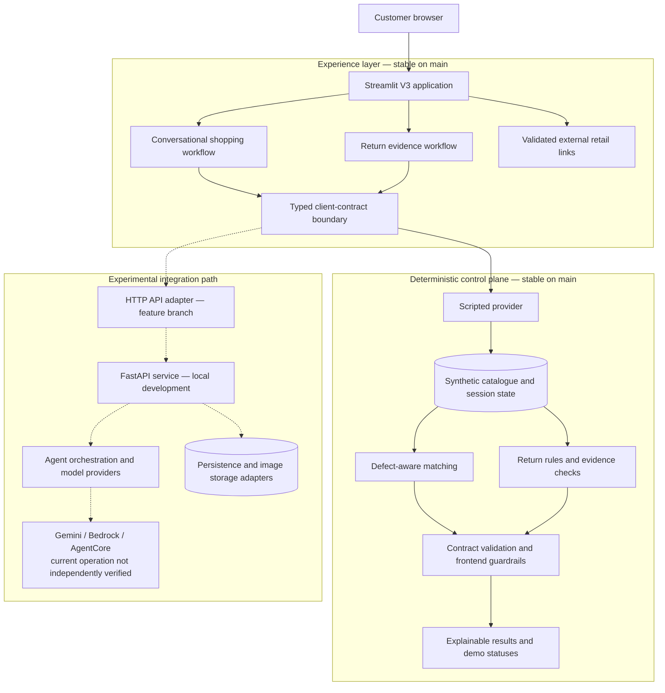

# AcceptMatch

**An agent-ready retail systems prototype for conversational preference capture, evidence-grounded product matching, and multimodal return intake.**

AcceptMatch originated at the **McGill–ALDO Retail Gen AI Hackathon 2026** around a practical circular-retail problem: how can returned or cosmetically imperfect products be matched to customers who explicitly accept their documented condition, while keeping product facts and business decisions auditable?

The system turns customer dialogue into structured preferences, evaluates those preferences against item-level defect evidence, and guides return requests through adaptive photo collection. A typed client boundary separates the Streamlit experience from the decision provider, making the architecture ready for backend agents without coupling safety-critical matching and return rules to model output. The stable `main` implementation uses a deterministic scripted provider for reproducibility; experimental branches extend the same boundary toward FastAPI and agent infrastructure.


## What is implemented on `main`

- **Conversational preference collection.** A guided assistant collects category, style, colour, price, acceptable defect types and severities, defect locations, and required working components. Answers can be reviewed and edited; stale or malformed turns are rejected.
- **Defect-aware matching.** Pure matching functions compare structured preferences with synthetic, item-level condition reports. Results distinguish verified matches from possible matches that still lack evidence.
- **Evidence-based guardrails.** Unknown evidence never counts as verified. Unaccepted defects, excessive severity, failed component checks, unavailable inventory, and unsupported agent claims are excluded or downgraded by deterministic frontend checks.
- **Transparent product results.** The interface shows the exact synthetic item, price, disclosed imperfections, condition evidence, match rationale, and missing checks. The current customer site does not perform checkout.
- **Return evidence workflow.** Customers can enter a demo order, describe an issue, receive an adaptive photo checklist, upload evidence, review the request, and retrieve a simulated status using a return ID and code.
- **Privacy-oriented image handling.** Uploaded images are validated, resized, normalized for orientation, and stripped of metadata such as GPS information. In mock mode, images are checked for presence and file quality constraints; their visual contents are **not** analyzed by AI.
- **Simulated outcomes with explicit boundaries.** Draft deterministic rules can produce demo outcomes such as approved, needs more information, manual review, or rejected. No real shipping label, refund, or merchant authorization is created.
- **Diagnostics and contract checks.** Optional diagnostics record configuration warnings and contract violations without changing decision rules.

## ML systems engineering highlights

- **Agent-ready contracts.** UI workflows depend on typed operations and validated response envelopes rather than a specific model SDK, allowing scripted and service-backed providers to share the same interaction surface.
- **Structured conversational state.** Context versions, request identifiers, idempotent operations, editable answers, and stale-turn rejection keep multi-step dialogue consistent across Streamlit reruns.
- **Deterministic control plane.** Matching, eligibility, evidence sufficiency, and customer-visible status remain in testable Python rules. A provider can interpret intent, but it cannot manufacture inventory facts or override guardrails.
- **Evidence provenance.** Each exact-item result carries condition evidence, verification status, exclusions, and missing checks; the frontend independently recomputes match safety before display.
- **Multimodal intake pipeline.** The return flow derives photo requirements from the reported issue, validates uploads, normalizes orientation, limits dimensions and memory use, and removes metadata before assessment.
- **Modular integration path.** The client boundary supports the published API-integration branch and additional local FastAPI/agent work while preserving a stable, offline demonstration on `main`.

## Architecture



Solid lines represent the code path available on `main`; dashed lines show the modular integration path developed on separate branches or in unpublished local work. The same contract boundary allows provider experiments while deterministic code remains authoritative for catalogue facts, matching, and demo decisions.

## Interface walkthrough

### Conversational preference workflow

The assistant asks one relevant question at a time and exposes the accumulated structured state for review and editing. The interface labels the active provider so the scripted demonstration cannot be mistaken for real LLM inference.


### Defect-aware matching results

Results are ranked by evidence quality and display exact-item defects, required component checks, availability, and price. A claimed verified match is downgraded or removed when the local guardrail layer cannot reproduce it from the evidence.


### Multimodal return evidence collection

The return workflow converts the reported issue into required and optional photo views. The current mock assessment checks evidence presence and file constraints; it does not claim computer-vision analysis.


## Technology and repository organization

| Area | Technology / location | Role |
|---|---|---|
| Application | Python 3.12, Streamlit; `app.py` | Customer-facing V3 entry point and routing |
| Screens | `ui/screens/` | Home, preference conversation, results, listing details, returns, and status |
| Client contracts | `ui/client/contracts.py` | Structured request/response shapes and validation |
| Scripted agent | `ui/client/mock_agent.py`, `ui/client/mock_conversation.py` | Deterministic conversation and idempotent demo operations |
| Matching | `ui/client/matching.py` | Pure defect, severity, location, price, and evidence rules |
| Guardrails | `ui/guardrails.py` | Re-validates listings and prevents unsupported “verified” claims |
| Demo state/data | `ui/client/mock_store.py`, `ui/client/seed.py`, `static/` | Synthetic inventory, condition records, and images |
| Return images | Pillow via `ui/images.py` | Validation, orientation correction, resizing, and metadata removal |
| Tests | pytest, Streamlit `AppTest`; `tests/ui/` | UI flows, contracts, matching, safety checks, and return behavior |
| Earlier prototype | `app_v1.py`, `ui/views/` | Preserved buyer/staff workflow; not the default application |

## Run locally

### Prerequisites

- Python 3.12 recommended
- macOS, Linux, or Windows with a shell capable of creating a virtual environment

### Setup

```bash
git clone https://github.com/darrickren/accept_match.git
cd accept_match
git checkout main

python3.12 -m venv .venv
source .venv/bin/activate        # Windows PowerShell: .venv\Scripts\Activate.ps1
python -m pip install -r requirements.txt
```

### Start the customer site

```bash
streamlit run app.py
```

The default configuration is self-contained: `ACCEPTMATCH_AGENT=mock` is implied, all catalogue records are synthetic, and no cloud credentials or external AI service are required. Optional diagnostics can be enabled with:

```bash
ACCEPTMATCH_DIAGNOSTICS=1 streamlit run app.py
```

Do not enter real order numbers, personal information, receipts, or customer photographs into this demonstration.

## Testing

Install the development dependencies and run the `main` UI suite:

```bash
python -m pip install -r requirements-dev.txt
PYTHONDONTWRITEBYTECODE=1 python -m pytest tests/ui -q -p no:cacheprovider
```

The repository audit and README validation run on October 25, 2026 verified:

```text
81 passed
```

These 81 tests are the applicable result for `main`. They cover the four-entry home page, scripted conversations, idempotency and stale-turn handling, catalogue invariants, defect-aware matching, frontend guardrails, image sanitation, return-state transitions, and customer-facing status behavior.

Experimental work has separate, broader suites. During the audit, the unpublished local backend worktree passed 180 UI, 69 backend, and 5 end-to-end tests. Those numbers are **not** `main` coverage and do not verify live Gemini, Amazon Bedrock, or AgentCore calls; the provider tests are offline or stubbed.

## Development status

| Branch / workstream | Status | Accurate interpretation |
|---|---|---|
| `main` | Stable scripted demonstration | Streamlit UI, synthetic inventory, deterministic conversation, matching, return workflow, and simulated decisions |
| `feature/customer-v3-agent-integration` | Published integration branch | Adds an HTTP/API adapter for connecting the customer journeys to a backend; kept separate from `main` |
| Local backend / AgentCore work | Experimental and not yet published | Includes additional FastAPI, persistence, provider, and deployment work. It has not been independently verified as a currently live service |

AcceptMatch does **not** claim a trained model, measured ML accuracy, production deployment, real-time inventory, or a currently active external LLM service. The design separates model-assisted interpretation from deterministic business constraints so that future experiments can be evaluated without weakening product, evidence, or transaction guardrails.

## Scope and limitations

- All inventory, product images, order identifiers, condition records, and outcomes are synthetic.
- The default assistant is scripted and deterministic; natural-language interpretation is intentionally limited.
- Mock return assessment does not inspect image contents and must not be presented as computer vision.
- The customer site does not implement checkout, payment, shipment, refund, or production authentication.
- Demo outcomes are not ALDO policy or decisions.
- The application has not been evaluated for production security, accessibility, scalability, or ML performance.
- Experimental cloud/provider work remains separate until its behavior, privacy boundaries, cost, and deployment state can be independently verified.

## Academic relevance

AcceptMatch is intended as a systems-oriented prototype rather than a model-training project. Its primary technical themes are structured human–agent interaction, deterministic constraints around probabilistic components, evidence provenance, idempotent state transitions, defensive contract validation, privacy-aware image handling, and honest separation between demonstrated behavior and experimental AI infrastructure.
