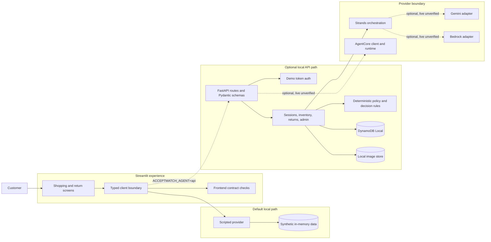

# Accept-Match

**A retail AI systems prototype for defect-aware product matching and evidence-guided returns.**

AcceptMatch began at the **McGill–ALDO Retail Gen AI Hackathon 2026**. It explores how a retailer could match
returned or cosmetically imperfect products with customers who explicitly accept the documented condition,
while keeping catalogue facts, evidence, and transaction rules outside the model.

This publication branch combines the working Streamlit demonstration with a FastAPI backend, local persistence,
typed agent contracts, provider adapters, deterministic guardrails, and offline integration tests. The default
experience remains fully local and scripted: `ACCEPTMATCH_AGENT=mock` is implied, no cloud credentials are needed,
and no paid model endpoint is called.


## Implementation status

| Capability | Status on this branch | What that means |
| --- | --- | --- |
| Streamlit customer demonstration | Implemented and offline-tested | The in-process scripted provider supports shopping, exact-item results, return intake, and return status. |
| FastAPI service with DynamoDB Local | Implemented and offline-tested | Routes, schemas, demo authentication, sessions, inventory, checkout simulation, uploads, returns, and admin simulation run locally. |
| Agent orchestration and structured output | Implemented and offline-tested | Shopping and return plans use Pydantic validation, bounded repair, read-only tools, and deterministic post-validation. |
| Gemini adapter | Protocol-tested with mocked HTTP | Request shape, tool schemas, image payloads, structured responses, error mapping, and limits are tested without Google API calls. Live inference is unverified on this publication branch. |
| Amazon Bedrock adapter | Tested with scripted models and AWS SDK stubs | Orchestration and failure handling are exercised without invoking Bedrock. Live inference is unverified on this publication branch. |
| Bedrock AgentCore client/runtime | Contract-tested with a local entry point and botocore stubs | Runtime payloads, inventory snapshots, response validation, and local re-verification are tested offline. A live runtime is not included or verified. |
| Authentication, checkout, fulfilment, and storage | Demo only | Credentials are local demo secrets, checkout and warehouse actions are simulations, DynamoDB is local, and images use the local filesystem. |

No trained model, model-quality benchmark, live inventory feed, production identity system, payment flow, refund,
shipment, or public cloud deployment is claimed.

## Architecture



The model-facing layer may extract preferences, choose the next question, or describe visible evidence. It cannot
authorize a purchase, create inventory facts, decide return eligibility, or bypass evidence requirements. The API
re-checks model output against DynamoDB Local and deterministic rules before returning customer-visible data.

## Customer experience

### Conversational preference capture

The assistant collects category, style, colour, size, budget, acceptable defect types and severities, locations,
and required working components. The customer can review or edit the structured state. Context versions and request
identifiers prevent stale or duplicated turns.


### Evidence-grounded matching

Results refer to exact synthetic units rather than generic SKUs. Each card carries disclosed defects, component
evidence, price, availability, and the reason it matched. Deterministic checks downgrade or remove an unsupported
"verified" match.


### Return evidence intake

The return journey turns a synthetic issue report into required photo views, validates and normalizes uploads,
removes image metadata, and applies deterministic evidence and policy checks. In mock mode, the system simulates
visual findings; it does not claim computer-vision analysis.


## Engineering highlights

- **Typed service boundary.** The Streamlit client validates every API envelope and refuses redirects, malformed
  payloads, incompatible versions, and unsafe image origins.
- **Structured agent output.** Pydantic schemas define shopping plans, return plans, photo findings, questions,
  and execution evidence. Invalid model output receives one bounded repair attempt and then fails closed.
- **Read-only model tools.** Agent tools search synthetic inventory, fetch item detail, look up a customer's own
  demo order, and read a versioned return policy. Mutating actions stay in deterministic services.
- **Decision guardrails.** Inventory availability, price, defect acceptance, required components, photo coverage,
  return policy, idempotency, and state transitions remain code-controlled.
- **Evidence provenance.** Responses identify the analysis source and may include redacted run metadata. Prompts,
  customer text, image bytes, credentials, and provider identifiers are not included in diagnostics.
- **Local-first persistence.** A DynamoDB repository runs against DynamoDB Local. A filesystem adapter stores
  synthetic seed images and local uploads. Both are development implementations, not production storage.
- **Synthetic data.** Catalogue units, orders, returns, product images, and generated evidence photos are synthetic.

## Repository map

| Area | Location |
| --- | --- |
| Streamlit entry points | `app.py` (current customer site), `app_v1.py` (earlier buyer/staff prototype) |
| Frontend integration | `ui/api_actions.py`, `ui/client/api_*.py`, `ui/client/http_api.py` |
| API and schemas | `backend/main.py`, `backend/schemas.py`, `backend/auth.py` |
| Agent orchestration | `backend/agent/strands_agent.py`, `backend/agent/prompts.py`, `backend/agent/preferences.py` |
| Provider adapters | `backend/agent/providers.py`, `backend/agent/agentcore_client.py`, `backend/agentcore/` |
| Persistence | `backend/repository.py`, `backend/storage.py` |
| Deterministic services | `backend/services/`, `backend/settings/`, `backend/policies/` |
| Synthetic seed data | `backend/seed/`, `static/`, `samples/` |
| Offline tests | `tests/ui/`, `tests/backend/`, `tests/e2e/` |

## Run the default Streamlit demo

Python 3.12 is recommended.

```bash
python3.12 -m venv .venv
source .venv/bin/activate
python -m pip install -r requirements-dev.txt
streamlit run app.py
```

The default configuration uses the in-process scripted provider and synthetic data. To make the choice explicit:

```bash
ACCEPTMATCH_AGENT=mock streamlit run app.py
```

Do not enter real customer information, order numbers, receipts, or photographs.

## Run the local FastAPI path

The backend uses a separate environment and a local DynamoDB process. Download DynamoDB Local from the official
AWS documentation, verify its published checksum, and extract it into `.local/dynamodb-local/`.

```bash
python3.12 -m venv .venv-backend
.venv-backend/bin/pip install -r requirements-backend.txt
.venv-backend/bin/python -m backend.scripts.dev secrets

# Four terminals or processes:
.venv-backend/bin/python -m backend.scripts.dev ddb
.venv-backend/bin/python -m backend.scripts.dev seed
.venv-backend/bin/python -m backend.scripts.dev api --mode mock
.venv-backend/bin/python -m backend.scripts.dev frontend
```

This path sets the frontend to `ACCEPTMATCH_AGENT=api`, while the API itself stays in `APP_MODE=mock`. See
[`docs/BACKEND.md`](docs/BACKEND.md) for local details and
[`docs/FRONTEND_AGENT_INTEGRATION.md`](docs/FRONTEND_AGENT_INTEGRATION.md) for the HTTP boundary.

## Tests

The suites are deliberately separate because the UI and backend use different environments.

```bash
PYTHONDONTWRITEBYTECODE=1 .venv/bin/python -m pytest tests/ui -q -p no:cacheprovider
PYTHONDONTWRITEBYTECODE=1 .venv-backend/bin/python -m pytest tests/backend -q -p no:cacheprovider
PYTHONDONTWRITEBYTECODE=1 .venv/bin/python -m pytest tests/e2e -q -p no:cacheprovider
```

Backend tests start a real DynamoDB Local process. End-to-end tests start DynamoDB Local and uvicorn, then drive
the Streamlit application with `AppTest`. Gemini traffic uses a mocked HTTP transport; Bedrock and AgentCore use
scripted models or botocore stubs. The test commands never call Google, Amazon Bedrock, AgentCore, or another paid
cloud service.

Local validation on October 25, 2026 produced:

```text
180 UI tests passed
69 backend tests passed
5 end-to-end tests passed
```

The default mock Streamlit process also started successfully, returned `ok` from `/_stcore/health`, and served the
root page with HTTP 200. The backend suite reported two upstream deprecation warnings from `bedrock-agentcore`;
there were no application test failures.

GitHub Actions runs the same three offline suites and performs a Gitleaks scan with full Git history available.

## Optional providers and publication boundary

The code supports `APP_MODE=gemini-local`, `bedrock-local`, and `agentcore`, but this branch does not contain keys,
account numbers, runtime ARNs, deployment state, CloudWatch identifiers, or infrastructure automation. Provider
settings belong in the process environment or ignored local files. The live paths require the reader's own cloud
account and explicit opt-in; they have not been independently exercised as part of this sanitized publication.

The public AgentCore note uses placeholders only: [`docs/AGENTCORE_PUBLIC.md`](docs/AGENTCORE_PUBLIC.md). The
original operational runbook and deployment script are intentionally excluded.

## Limitations

- Demo authentication uses locally generated shared passwords and HMAC bearer tokens. It is not a production
  identity system.
- Checkout, warehouse inspection, return approval, fulfilment, refund, and commerce links are simulations.
- DynamoDB Local and the local image store do not provide production durability, isolation, encryption policy,
  backups, retention controls, or object-level authorization.
- The mock agent has intentionally narrow language coverage. Provider tests establish contracts and failure
  handling, not answer quality, latency, safety, or availability against live models.
- Uploaded files receive defensive image processing, but the application has not completed a production security,
  privacy, accessibility, load, or abuse-resistance review.
- The Phase 1 presentation remains a historical project artifact; publication should preserve its third-party
  attributions and event context.

## Responsible use

All records and outcomes in this repository are synthetic. AcceptMatch does not represent ALDO policy or an ALDO
production system. Treat it as an ML systems and software engineering portfolio project, not a customer service,
commerce, or returns decision system.
