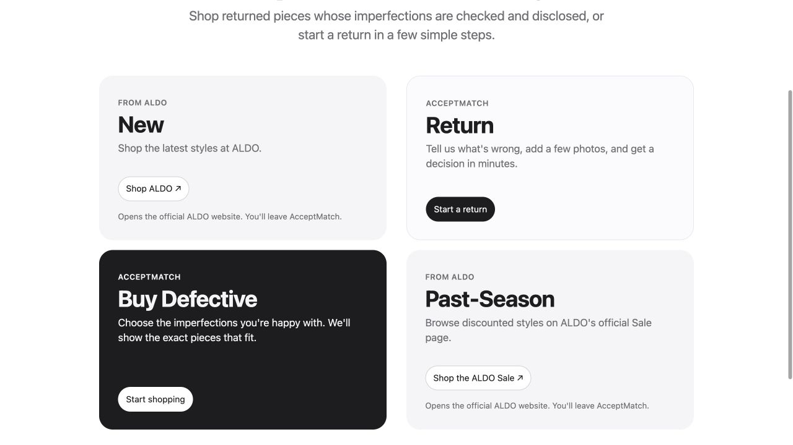
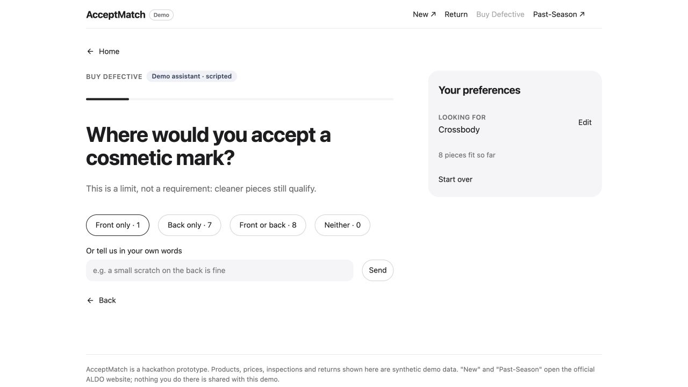
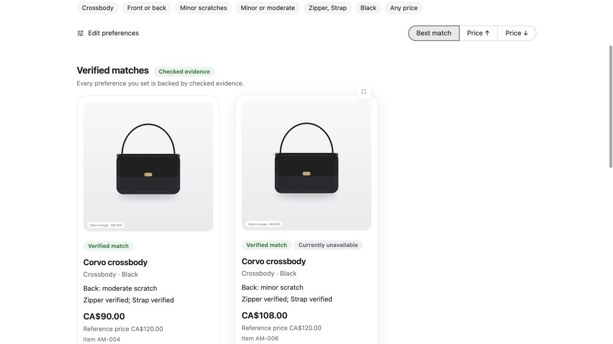
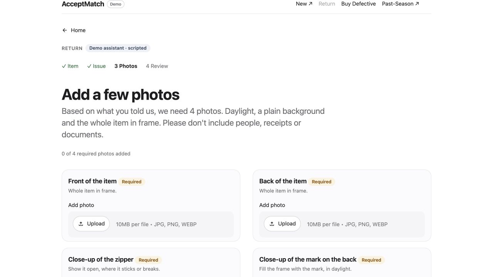
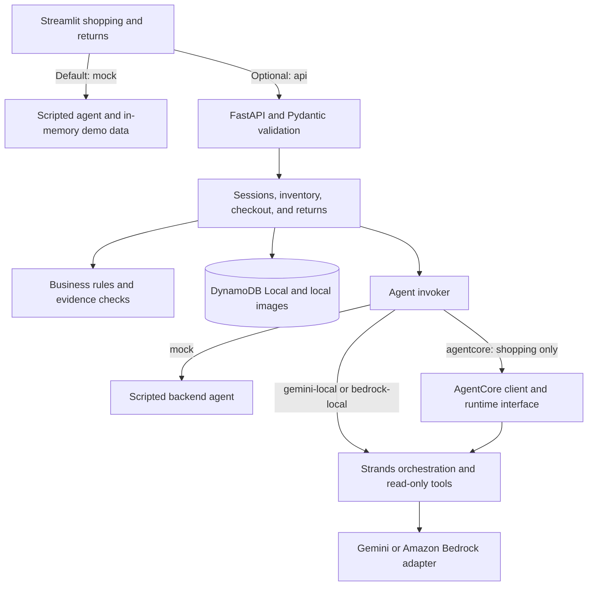

# Accept-Match

[](https://github.com/darrickren/accept_match/actions/workflows/offline-ci.yml)

Accept-Match helps shoppers find returned or cosmetically imperfect items that meet their preferences, including
which defects they will accept. It also guides customers through reporting an issue, submitting photos, and
tracking a simulated return.

The project began at the McGill–ALDO Retail Gen AI Hackathon 2026 and now includes a Streamlit interface,
a FastAPI backend, and optional model integrations.

## Live demo

**[Try Accept-Match →](https://accept-match-demo.streamlit.app/)**

The public demo uses synthetic data and a scripted mock agent. No cloud credentials are needed to run the same
experience locally.

## Customer experience



Start a shopping or return journey from the home page. “New” and “Past-Season” link to ALDO's external website.

### Find an item you would accept

The shopping flow collects category, style, colour, size, budget, acceptable defects and their locations, and
required working components. Customers can review and edit their preferences before choosing an item.

<table>
  <tr>
    <td width="50%"><a href="docs/images/preferences.jpg"></a></td>
    <td width="50%"><a href="docs/images/matching-results.jpg"></a></td>
  </tr>
  <tr>
    <td>Choose the imperfections you can accept.</td>
    <td>Compare individual items and their recorded condition.</td>
  </tr>
</table>

Results describe specific synthetic units, rather than generic product listings. Each card shows defects,
component evidence, price, availability, and why the item fits. Code checks the supporting evidence before
presenting a match as verified; customers must accept the disclosed defects before simulated checkout.

### Submit and track a return



The return flow asks about the item and issue, requests the relevant photo views, and lets the customer review
and submit the case. Customers can check its status and provide more evidence when requested. Visual findings
and return outcomes in the public demo are simulated.

## How it works

The default Streamlit path runs entirely in process. The optional API path connects the same interface to FastAPI,
DynamoDB Local, and a local image store. Model credentials stay in the backend.



`ACCEPTMATCH_AGENT` selects the frontend path (`mock` or `api`). In API mode, `APP_MODE` selects the backend agent.
AgentCore mode keeps returns on the scripted backend agent.

The model layer can interpret preferences, choose questions, and propose a plan. Backend services check item IDs
against stored inventory and enforce price, availability, defect acceptance, component evidence, and return policy.
Models cannot authorize purchases or change inventory directly.

## Engineering highlights

- **FastAPI and Pydantic.** Request and response schemas, demo token authentication, role checks, size limits, and
  consistent error responses define the API boundary. The frontend validates responses and API versions, refuses
  redirects, and restricts image origins before updating screen state.
- **Agent orchestration.** Strands uses typed shopping and return plans with read-only tools for inventory search,
  item details, the customer's own demo order, and a versioned return policy. Model calls have deadlines and tool
  limits. Invalid output gets one repair attempt; a second failure returns an error.
- **Provider integrations.** Gemini and Amazon Bedrock adapters share the orchestration layer. The AgentCore client
  sends a limited inventory snapshot to a runtime interface; the local API re-checks returned item IDs. These
  integrations are tested offline; live inference and a public AgentCore deployment are unverified.
- **State and persistence.** DynamoDB Local stores sessions, inventory, orders, and returns. Conditional writes and
  transactions protect state transitions. Request IDs and idempotency keys prevent duplicate chat replies,
  checkout operations, and return cases.
- **Rules and image handling.** Code enforces accepted defects, required components, photo coverage, and return
  eligibility. Backend uploads are decoded, checked for image quality and duplicates, and re-encoded without image
  metadata. These image checks are separate from model-generated observations.
- **Diagnostics.** Responses identify the analysis source and can include redacted execution metadata. Diagnostics
  exclude customer text, prompts, image bytes, credentials, and provider identifiers.

## Testing

Recorded local validation on October 25, 2026:

| Suite | Result | Coverage |
| --- | --- | --- |
| UI | 180 passed | Matching, returns, client validation, and complete flows against a fake API |
| Backend | 69 passed | Real DynamoDB Local, API services, rules, and agent interfaces |
| End-to-end | 5 passed | Streamlit `AppTest` against FastAPI and DynamoDB Local in mock mode |

[Offline CI](https://github.com/darrickren/accept_match/actions/workflows/offline-ci.yml) runs all three suites
and scans the working tree and Git history with Gitleaks.

Gemini tests use mocked HTTP; Bedrock and AgentCore tests use scripted models or AWS SDK stubs. The suites do not
call paid cloud services. They verify application behavior, integration interfaces, and failure handling, rather
than live model quality, latency, or availability.

To reproduce the tests after completing the local setup below, run each suite separately:

```bash
PYTHONDONTWRITEBYTECODE=1 .venv/bin/python -m pytest tests/ui -q -p no:cacheprovider
PYTHONDONTWRITEBYTECODE=1 .venv-backend/bin/python -m pytest tests/backend -q -p no:cacheprovider
PYTHONDONTWRITEBYTECODE=1 .venv/bin/python -m pytest tests/e2e -q -p no:cacheprovider
```

The backend suite starts DynamoDB Local; the end-to-end suite starts both DynamoDB Local and uvicorn. Earlier
local smoke checks also confirmed Streamlit's `/_stcore/health` response and HTTP 200 at the root page. The recorded
backend run had two upstream `bedrock-agentcore` deprecation warnings and no application test failures.

## Run locally

### Streamlit demo

Python 3.12 is recommended. From the repository root:

```bash
git clone https://github.com/darrickren/accept_match.git
cd accept_match
python3.12 -m venv .venv
source .venv/bin/activate
python -m pip install -r requirements-dev.txt
streamlit run app.py
```

Open `http://localhost:8501`. The scripted provider is the default; to select it explicitly:

```bash
ACCEPTMATCH_AGENT=mock streamlit run app.py
```

Use synthetic inputs only; do not submit real customer information, receipts, or photographs.

### Optional FastAPI and DynamoDB Local setup

Keep the frontend environment above and create a separate backend environment. This path also requires Java 17
or later and DynamoDB Local. Download DynamoDB Local using the
[official AWS setup guide](https://docs.aws.amazon.com/amazondynamodb/latest/developerguide/DynamoDBLocal.DownloadingAndRunning.html),
verify its published checksum, and extract it into `.local/dynamodb-local/`.

```bash
python3.12 -m venv .venv-backend
.venv-backend/bin/pip install -r requirements-backend.txt
.venv-backend/bin/python -m backend.scripts.dev secrets
```

Start DynamoDB Local in its own terminal:

```bash
.venv-backend/bin/python -m backend.scripts.dev ddb
```

Once it is running, seed the synthetic data:

```bash
.venv-backend/bin/python -m backend.scripts.dev seed
```

Then run the API and frontend in separate terminals, stopping the earlier standalone Streamlit process first:

```bash
# API terminal
.venv-backend/bin/python -m backend.scripts.dev api --mode mock

# Frontend terminal
.venv-backend/bin/python -m backend.scripts.dev frontend
```

The frontend helper selects `ACCEPTMATCH_AGENT=api` and supplies local demo credentials. The backend stays in
`APP_MODE=mock`. Open the site at `http://127.0.0.1:8501` and the API reference at `http://127.0.0.1:8000/docs`.

See the [backend guide](docs/BACKEND.md) for configuration and routes, the
[frontend integration guide](docs/FRONTEND_AGENT_INTEGRATION.md) for HTTP behavior, and the
[AgentCore integration note](docs/AGENTCORE_PUBLIC.md) for the client/runtime interface.

### Optional model modes

The backend implements `APP_MODE=gemini-local`, `bedrock-local`, and `agentcore`. These require your own provider
configuration and credentials. Keep secrets in the process environment or ignored local files. This repository
includes placeholder configuration, but excludes operational deployment runbooks, infrastructure automation,
and live account or runtime identifiers. There is no automatic fallback between modes.

## Repository map

| Area | Entry points |
| --- | --- |
| Customer interface | `app.py`, `ui/screens/` |
| HTTP client and response validation | `ui/api_actions.py`, `ui/client/api_*.py`, `ui/client/http_api.py` |
| API, authentication, and schemas | `backend/main.py`, `backend/auth.py`, `backend/schemas.py` |
| Agents and provider adapters | `backend/agent/`, `backend/agentcore/` |
| Persistence and image storage | `backend/repository.py`, `backend/storage.py` |
| Business rules and services | `backend/services/`, `backend/settings/`, `backend/policies/` |
| Synthetic data and images | `backend/seed/`, `static/`, `samples/` |
| Automated tests | `tests/ui/`, `tests/backend/`, `tests/e2e/` |

## Limitations and project context

- The public demo's scripted agent has limited language coverage. Photo submission does not establish validated
  computer-vision analysis. The project does not train a model or report model-quality benchmarks.
- Products, inventory, orders, images, and example evidence are synthetic. Checkout, warehouse inspection,
  reviews, return decisions, fulfilment, and refunds are simulations; there are no commercial transactions.
- Authentication uses local demo passwords and HMAC bearer tokens. DynamoDB Local and filesystem storage are
  development implementations, without production identity, durability, backup, retention, or object-authorization
  guarantees. The application has not completed production security, privacy, accessibility, or load reviews.
- Only the Streamlit mock experience is presented as the public demo. FastAPI and DynamoDB Local have been
  verified locally; provider tests do not establish a working cloud deployment or production readiness.

Accept-Match is a student portfolio project with hackathon origins. It does not represent ALDO policy, endorsement,
or deployment. The earlier buyer/staff prototype remains in `app_v1.py`; the Phase 1 presentation is a historical
artifact whose third-party attributions and event context are preserved.
