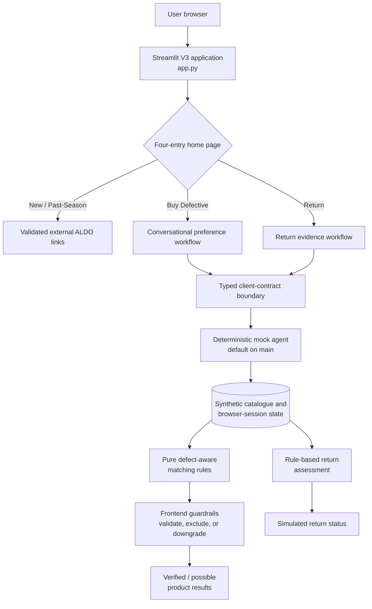

# AcceptMatch

**A defect-aware retail prototype for matching returned merchandise with customers whose preferences are compatible with each item's documented condition.**

AcceptMatch originated in the context of the **McGill–ALDO Retail Gen AI Hackathon 2026**. The project explores a practical retail question: can returned or cosmetically imperfect products be described transparently, matched against a customer's stated tolerances, and kept in circulation without allowing an automated assistant to invent product facts or make unsupported decisions?

The `main` branch is a stable, local Streamlit demonstration built entirely with synthetic data and deterministic rules. Its conversational interface is scripted rather than powered by a language model. Checkout, shipping, refunds, and merchant decisions are simulated or explicitly out of scope.

> AcceptMatch is a hackathon prototype, not an official ALDO service. It does not implement production commerce or return-policy decisions.

## What is implemented on `main`

- **Conversational preference collection.** A guided assistant collects category, style, colour, price, acceptable defect types and severities, defect locations, and required working components. Answers can be reviewed and edited; stale or malformed turns are rejected.
- **Defect-aware matching.** Pure matching functions compare structured preferences with synthetic, item-level condition reports. Results distinguish verified matches from possible matches that still lack evidence.
- **Evidence-based guardrails.** Unknown evidence never counts as verified. Unaccepted defects, excessive severity, failed component checks, unavailable inventory, and unsupported agent claims are excluded or downgraded by deterministic frontend checks.
- **Transparent product results.** The interface shows the exact synthetic item, price, disclosed imperfections, condition evidence, match rationale, and missing checks. The current customer site does not perform checkout.
- **Return evidence workflow.** Customers can enter a demo order, describe an issue, receive an adaptive photo checklist, upload evidence, review the request, and retrieve a simulated status using a return ID and code.
- **Privacy-oriented image handling.** Uploaded images are validated, resized, normalized for orientation, and stripped of metadata such as GPS information. In mock mode, images are checked for presence and file quality constraints; their visual contents are **not** analyzed by AI.
- **Simulated outcomes with explicit boundaries.** Draft deterministic rules can produce demo outcomes such as approved, needs more information, manual review, or rejected. No real shipping label, refund, or merchant authorization is created.
- **Diagnostics and contract checks.** Optional diagnostics record configuration warnings and contract violations without changing decision rules.

## Architecture



The client boundary deliberately separates presentation code from the decision provider. On `main`, that provider is a deterministic mock. Experimental branches use the same boundary for HTTP/backend integration, but those paths are not part of the stable `main` implementation.

## Technology and repository organization

| Area | Technology / location | Role |
|---|---|---|
| Application | Python 3.12, Streamlit; `app.py` | Customer-facing V3 entry point and routing |
| Screens | `ui/screens/` | Home, preference conversation, results, listing details, returns, and status |
| Client contracts | `ui/client/contracts.py` | Structured request/response shapes and validation |
| Scripted agent | `ui/client/mock_agent.py`, `ui/client/mock_conversation.py` | Deterministic conversation and idempotent demo operations |
| Matching | `ui/client/matching.py` | Pure defect, severity, location, price, and evidence rules |
| Guardrails | `ui/guardrails.py` | Re-validates listings and prevents unsupported “verified” claims |
| Demo state/data | `ui/client/mock_store.py`, `ui/client/seed.py`, `static/` | Synthetic inventory, condition records, and images |
| Return images | Pillow via `ui/images.py` | Validation, orientation correction, resizing, and metadata removal |
| Tests | pytest, Streamlit `AppTest`; `tests/ui/` | UI flows, contracts, matching, safety checks, and return behavior |
| Earlier prototype | `app_v1.py`, `ui/views/` | Preserved buyer/staff workflow; not the default application |

## Run locally

### Prerequisites

- Python 3.12 recommended
- macOS, Linux, or Windows with a shell capable of creating a virtual environment

### Setup

```bash
git clone https://github.com/darrickren/accept_match.git
cd accept_match
git checkout main

python3.12 -m venv .venv
source .venv/bin/activate        # Windows PowerShell: .venv\Scripts\Activate.ps1
python -m pip install -r requirements.txt
```

### Start the customer site

```bash
streamlit run app.py
```

The default configuration is self-contained: `ACCEPTMATCH_AGENT=mock` is implied, all catalogue records are synthetic, and no cloud credentials or external AI service are required. Optional diagnostics can be enabled with:

```bash
ACCEPTMATCH_DIAGNOSTICS=1 streamlit run app.py
```

Do not enter real order numbers, personal information, receipts, or customer photographs into this demonstration.

## Testing

Install the development dependencies and run the `main` UI suite:

```bash
python -m pip install -r requirements-dev.txt
PYTHONDONTWRITEBYTECODE=1 python -m pytest tests/ui -q -p no:cacheprovider
```

The repository audit and README validation run on October 25, 2026 verified:

```text
81 passed
```

These 81 tests are the applicable result for `main`. They cover the four-entry home page, scripted conversations, idempotency and stale-turn handling, catalogue invariants, defect-aware matching, frontend guardrails, image sanitation, return-state transitions, and customer-facing status behavior.

Experimental work has separate, broader suites. During the audit, the unpublished local backend worktree passed 180 UI, 69 backend, and 5 end-to-end tests. Those numbers are **not** `main` coverage and do not verify live Gemini, Amazon Bedrock, or AgentCore calls; the provider tests are offline or stubbed.

## Development status

| Branch / workstream | Status | Accurate interpretation |
|---|---|---|
| `main` | Stable scripted demonstration | Streamlit UI, synthetic inventory, deterministic conversation, matching, return workflow, and simulated decisions |
| `feature/customer-v3-agent-integration` | Published integration branch | Adds an HTTP/API adapter for connecting the customer journeys to a backend; kept separate from `main` |
| Local backend / AgentCore work | Experimental and not yet published | Includes additional FastAPI, persistence, provider, and deployment work. It has not been independently verified as a currently live service |

AcceptMatch does **not** claim a trained model, measured ML accuracy, production deployment, real-time inventory, or a currently active external LLM service. The design separates model-assisted interpretation from deterministic business constraints so that future experiments can be evaluated without weakening product, evidence, or transaction guardrails.

## Recommended screenshots

For a portfolio-ready README, use only synthetic demo data and place screenshots as follows:

| Placement | Suggested capture | Purpose |
|---|---|---|
| Immediately below the introduction | Four-entry home page | Establishes the product and retail-oriented interface |
| After “What is implemented” | Preference question beside the editable preference summary | Demonstrates structured conversational collection without implying an LLM |
| After the architecture diagram | Ranked results plus an exact-item condition report | Shows explainable matching, disclosed defects, and verified/possible labels |
| Beside the return-workflow description | Adaptive photo checklist and a clearly labelled demo outcome | Shows evidence collection and decision boundaries |

Suggested repository paths are `docs/images/home.png`, `docs/images/preferences.png`, `docs/images/match-report.png`, and `docs/images/return-evidence.png`. Crop browser chrome where practical, retain the on-screen demo disclaimers, and verify that no personal information or internal documents are visible before committing images.

## Scope and limitations

- All inventory, product images, order identifiers, condition records, and outcomes are synthetic.
- The default assistant is scripted and deterministic; natural-language interpretation is intentionally limited.
- Mock return assessment does not inspect image contents and must not be presented as computer vision.
- The customer site does not implement checkout, payment, shipment, refund, or production authentication.
- Demo outcomes are not ALDO policy or decisions.
- The application has not been evaluated for production security, accessibility, scalability, or ML performance.
- Experimental cloud/provider work remains separate until its behavior, privacy boundaries, cost, and deployment state can be independently verified.

## Academic relevance

AcceptMatch is intended as a systems-oriented prototype rather than a model-training project. Its primary technical themes are structured human–agent interaction, deterministic constraints around probabilistic components, evidence provenance, idempotent state transitions, defensive contract validation, privacy-aware image handling, and honest separation between demonstrated behavior and experimental AI infrastructure.
